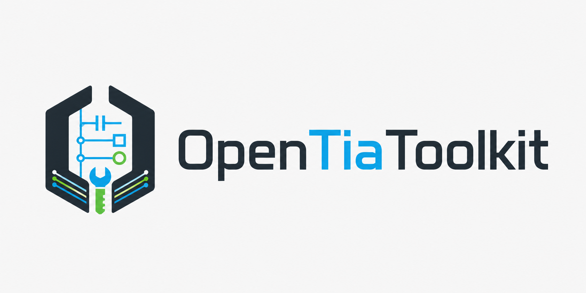
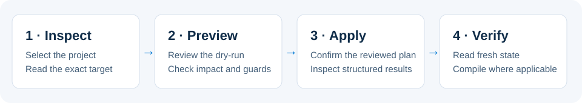
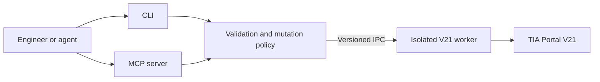

<p align="center">
  
</p>

<p align="center"><strong>Automate Siemens TIA Portal V21 engineering with a Windows CLI and MCP server.</strong></p>

<p align="center">
  
  
  
  <a href="LICENSE"></a>
</p>

OpenTiaToolkit helps engineers and coding agents inspect projects, author PLC code, edit WinCC Unified screens, and configure hardware through one shared catalog of **186 commands**. Reviewed previews, explicit confirmation, state checks, and read-back make engineering changes easier to assess.

- **Inspect a project:** discover TIA instances, PLC blocks, HMI screens, tags, and hardware.
- **Change PLC code:** plan source or block changes, inspect their impact, compile, and verify the resulting objects.
- **Edit Unified HMI:** read a screen as JSON, preview a targeted patch, apply it, and check the saved state.

<p align="center"><a href="#quick-start">Quick start</a> · <a href="https://github.com/mistik91/OpenTiaToolkit/releases">Downloads</a> · <a href="docs/RELEASE_NOTES_1.0.0-preview.8.md">Preview.8 notes</a> · <a href="docs/generated/COMMAND_REFERENCE.md">Command reference</a> · <a href="CONTRIBUTING.md">Contribute</a></p>

> [!IMPORTANT]
> **1.0.0-preview.8 is an unsigned preview candidate.** Independent first-install/PLC, scoped Unified screen editing/compile, and scoped Startdrive acceptance have passed. Publication is pending; the repository remains private and the release draft. See the [qualification matrix and known limitations](docs/PREVIEW8_ACCEPTANCE.md) before choosing a workflow. Verify SHA-256 checksums, run `doctor`, and start write workflows on disposable project copies with independent backups. TIA Portal V21 is the only supported major version.

## Quick start

### Requirements

- Windows with .NET Framework 4.8 and Siemens TIA Portal V21 with Openness enabled.
- Membership in the **Siemens TIA Openness** Windows group; sign out and back in after changing membership.
- Administrator access to install under Program Files and register the exact V21 worker with Siemens Openness.
- The Siemens engineering licenses required by the workflow; see the [support matrix](#compatibility).
- An MCP client if you want agent integration.

### Install a preview

When preview.8 is published, obtain `OpenTiaToolkit-1.0.0-preview.8-Setup.exe`, `INSTALLER-SHA256SUMS.txt`, and `UNSIGNED-NOTICE.txt` from the [release page](https://github.com/mistik91/OpenTiaToolkit/releases). Check the version explicitly: previews may not appear as GitHub's latest stable release. Before publication, draft downloads require authorized repository access. [Building from source](#build-from-source) is a separate contributor workflow; it does not reproduce acceptance of the supplied installer.

Verify the installer before running it:

```powershell
$expected = (Get-Content .\INSTALLER-SHA256SUMS.txt).Split()[0]
$actual = (Get-FileHash .\OpenTiaToolkit-1.0.0-preview.8-Setup.exe -Algorithm SHA256).Hash
if ($actual.ToLowerInvariant() -ne $expected.ToLowerInvariant()) { throw "Installer checksum mismatch" }
```

Run Setup and keep **Register the isolated OpenTiaToolkit V21 worker with Siemens Openness** selected. Open a new terminal:

```powershell
& "C:\Program Files\OpenTiaToolkit\cli\OpenTiaToolkit.CLI.exe" version
& "C:\Program Files\OpenTiaToolkit\cli\OpenTiaToolkit.CLI.exe" doctor
& "C:\Program Files\OpenTiaToolkit\cli\OpenTiaToolkit.CLI.exe"
```

In the interactive CLI, select an existing TIA instance and inspect its project:

```text
list-instances
connect-instance --instance-id=<process-id>
list-projects
list-devices
portal-status
```

Keep connected workflows in one interactive or [script session](docs/CLI_USAGE.md). Follow [setup and troubleshooting](docs/SETUP.md) for non-standard installations.

### Connect your agent

For client packages and configuration examples, use the [plugin installation guide](docs/INSTALL_AGENT_PLUGINS.md) or [client configuration matrix](docs/mcp-client-configs/README.md). The preview.8 portable integration was exercised in Codex; the presence of a package for another client does not establish installed acceptance in that client. Enable one OpenTia integration per client. A typical stdio configuration is:

```json
{
  "mcpServers": {
    "opentia": {
      "command": "C:\\Program Files\\OpenTiaToolkit\\mcp\\OpenTiaToolkit.MCP.exe",
      "args": [],
      "env": {
        "OPEN_TIA_MCP_LOG_LEVEL": "Error",
        "OPEN_TIA_MCP_TOOL_TIMEOUT_SECONDS": "600"
      }
    }
  }
}
```

The portable [Agent Plugins package](plugins/opentia-toolkit-agent-plugin) includes 18 engineering workflow skills and a launcher that finds the installed MCP server. Product binaries and TIA must be installed separately.

## Review, apply, verify



Start with a read of the exact project and target. Use the operation's preview or dry-run and inspect its diagnostics. Confirm the reviewed change, then perform a fresh read and compile where applicable. Examples are included for [PLC tags](examples/blueprints/ensure-plc-tags.json), [Unified screens](examples/blueprints/create-unified-screen.json), and [PROFINET devices](examples/blueprints/configure-profinet-device.json).

Blueprints orchestrate reviewed steps sequentially. Earlier successful steps remain applied if a later step fails; use the [completion and recovery guidance](docs/BLUEPRINTS.md#completion-and-partial-failures). Individual PLC, HMI, and hardware transaction workflows have their own rollback boundaries.

## What you can automate

This table describes the exposed command surface. Independent preview.8 acceptance covers a smaller set of targets and operations; consult the [qualification matrix](docs/PREVIEW8_ACCEPTANCE.md). Features outside that matrix require validation on your disposable fixture before use.

| Area | Workflows |
|---|---|
| Projects | Discover and connect to TIA, open/create/retrieve/archive projects, inspect project trees |
| PLC | Blocks, native SCL and S7DCL authoring, tags, cross-references, compilation, persistent code transactions, guarded PLCSIM Advanced probes |
| WinCC Unified | Screen JSON read/diff/patch, tags, discrete alarms, trends and logging, texts and faceplate inspection |
| Hardware | Catalog discovery, modules, PROFINET identity and wiring, IO addresses, Startdrive telegrams, GSD/GSDML parameters |
| VCI and libraries | Workspace mappings and synchronization, library inspection and master copies, project-language import/export |
| Collaboration | Identity-bound Multiuser inspection and local-session workflows; check-in is handed to the owning TIA UI |

Use the [CLI reference](docs/generated/COMMAND_REFERENCE.md), [MCP reference](docs/generated/MCP_TOOL_REFERENCE.md), and [machine-readable catalog](docs/generated/command-catalog.json) for exact commands and arguments.

## Compatibility

| Component | Scope |
|---|---|
| TIA Portal | V21 only; scoped installed tests cover Update 2 Hotfix 1 and Update 3. The retained binary benchmark is Update 2; run `doctor` after updates or hotfixes |
| Older/newer TIA majors | V20 and earlier, V22 and later are unsupported |
| PLC engineering | The required STEP 7 edition/license and target capabilities must be available; doctor does not verify licensing |
| HMI | WinCC Unified engineering; workflow-specific licenses and culture configuration are required |
| Simulation | PLCSIM Advanced is optional and required for simulator download/behavior workflows; physical PLC downloads are outside those guarded workflows |
| Drives and collaboration | Appropriate Startdrive and Multiuser/Project Server components and licenses are required |

Validation is specific to documented targets and workflows. Update 3 PLC acceptance does not qualify its changed Unified binary for HMI editing. A healthy `doctor` with compatible API/hash warnings does not prove licensing readiness or live engineering behavior. See [qualification and known limitations](docs/PREVIEW8_ACCEPTANCE.md), [version support](docs/TIA_PORTAL_VERSION_SUPPORT.md), and [API compatibility](docs/API_COMPATIBILITY.md).

## Architecture and safety



CLI and MCP stay vendor-free. A version-specific worker owns Siemens objects and serializes requests. Central mutation policy requires confirmation; supported previews and transaction checks constrain changes. Results preserve blocked, partial, rollback, and transport outcomes. Audit records redact secrets and apply tokens, and MCP file access is constrained by allowed roots and size/overwrite policy.

Blueprint tokens are short-lived, single-use, and bound to desired state and project context. Keep backups and review domain-level concurrency checks before applying changes. Read [production architecture and recovery](docs/PRODUCTION_ARCHITECTURE.md) and [security policy](SECURITY.md) for details.

## Build from source

Install the .NET SDK selected by [global.json](global.json), the .NET Framework 4.8 targeting tools, and TIA Portal V21 PublicAPI. Then:

```powershell
git clone https://github.com/mistik91/OpenTiaToolkit.git
cd OpenTiaToolkit
dotnet restore .\OpenTiaToolkit.sln --locked-mode
dotnet build .\OpenTiaToolkit.sln -c Release --no-restore
```

The default Siemens reference path is `C:\Program Files\Siemens\Automation\Portal V21\PublicAPI\V21\net48`. After rebuilding, register the exact worker from an elevated PowerShell session:

```powershell
powershell -NoProfile -ExecutionPolicy Bypass -File .\scripts\Register-OpennessAllowList.ps1 `
  -ExecutablePath .\src\OpenTiaToolkit.Worker.V21\bin\Release\net48\OpenTiaToolkit.Worker.V21.exe
```

See [contribution guidance](CONTRIBUTING.md), [developer setup](docs/DEV_GUIDE.md), and the [release checklist](docs/RELEASE_CHECKLIST.md). Hosted CI covers vendor-free hosts and architecture; licensed validation is run separately on reviewed release commits.

## Documentation and support

| Getting started | Engineering and reference |
|---|---|
| [Setup](docs/SETUP.md) | [PLC/CLI workflows](docs/CLI_USAGE.md) |
| [Agent plugins](docs/INSTALL_AGENT_PLUGINS.md) | [Hardware automation](docs/HARDWARE_AUTOMATION.md) |
| [MCP client configs](docs/mcp-client-configs/README.md) | [Blueprints](docs/BLUEPRINTS.md) |
| [Preview.8 qualification](docs/PREVIEW8_ACCEPTANCE.md) and [release notes](docs/RELEASE_NOTES_1.0.0-preview.8.md) | [MCP protocol](docs/MCP_PROTOCOL.md) |
| [Report a bug](https://github.com/mistik91/OpenTiaToolkit/issues/new/choose) | [Supply chain](docs/SUPPLY_CHAIN.md) |

Report security issues through the private route in [SECURITY.md](SECURITY.md). Avoid sharing proprietary projects, credentials, or Siemens binaries in issue reports.

## License

[MIT License](LICENSE). Siemens and TIA Portal are trademarks of Siemens AG. OpenTiaToolkit is an independent project and is not affiliated with or endorsed by Siemens AG. Siemens software and official manuals are not bundled; install and license TIA separately.
