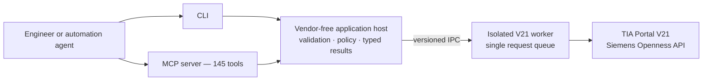

<p align="center">
  
</p>

<p align="center">
  Safety-first automation for Siemens TIA Portal V21 through one shared CLI, MCP, and blueprint surface.
</p>

<p align="center">
  
  
  
  
</p>

<p align="center">
  <a href="#quick-start">Quick start</a> ·
  <a href="#what-you-can-automate">Capabilities</a> ·
  <a href="#architecture">Architecture</a> ·
  <a href="docs/generated/COMMAND_REFERENCE.md">142 commands</a> ·
  <a href="docs/BLUEPRINTS.md">Blueprints</a> ·
  <a href="docs/SETUP.md">Documentation</a>
</p>

---

OpenTiaToolkit is an open-source Windows engineering automation platform for Siemens TIA Portal Openness. It exposes the same versioned command catalog through a human-friendly CLI, an MCP server for coding agents, and declarative blueprints for repeatable engineering outcomes.

The toolkit supports **TIA Portal V21 only**. V20 is not supported. V22 and later require a dedicated worker package, compatibility profile, and live validation before support is claimed.

> [!IMPORTANT]
> The current public build is [`1.0.0-preview.1`](https://github.com/mistik91/OpenTiaToolkit/releases/tag/v1.0.0-preview.1) and is **unsigned**. Windows may show an unknown-publisher or SmartScreen warning. Verify the published SHA-256 before installation. A signed stable `1.0.0` release will follow.

## Why OpenTiaToolkit

| Capability | What it provides |
|---|---|
| One shared surface | 142 commands implemented once and exposed consistently through CLI and MCP |
| Safe mutations | Central policy, previews, explicit confirmation, typed outcomes, read-back checks, and redacted audit records |
| Process isolation | Siemens objects stay inside a disposable V21 worker with a serialized request queue |
| Declarative automation | State-bound blueprints turn reviewed PLC, HMI, and hardware intent into previewable plans |
| Explicit compatibility | `doctor`, assembly hashes, API self-description, capability probes, and migration diffs |
| Agent-ready workflows | Packaged skills and client configurations for Codex, Claude, OpenCode, VS Code, and other MCP clients |

## What You Can Automate

| Domain | Representative workflows |
|---|---|
| Projects and sessions | Discover or launch TIA, connect to instances, create/open/retrieve/archive projects, inspect project trees |
| PLC engineering | Browse software, compile, import/export blocks and sources, manage tags, cross-references, online compare, guarded PLCSIM Advanced operations |
| Unified HMI | Browse and edit screens, tags, trends and logging; JSON snapshot/diff/patch/import; alarms, runtime settings, text lists and faceplate probes |
| Hardware and drives | Catalog discovery, module placement, PROFINET identity and wiring, IO addressing, Startdrive telegrams and parameters, GSD/GSDML changes |
| VCI | Create workspaces, map S7DCL content, inspect status, and synchronize individual objects or complete PLC selections |
| Libraries and texts | Project/global library inspection, master-copy workflows, update checks, project-language workbook import/export |
| Safety and operations | Safety validation insight, multiuser/security inspection, credential references, paging, cancellation, recovery and audit trails |

Browse the [generated command reference](docs/generated/COMMAND_REFERENCE.md), [MCP tool reference](docs/generated/MCP_TOOL_REFERENCE.md), or [machine-readable catalog](docs/generated/command-catalog.json) for the complete surface.

## Architecture



CLI and MCP do not load Siemens assemblies. They validate requests, enforce centralized mutation policy, and communicate with a version-specific worker over private IPC. The worker owns every Siemens portal, project, PLC, and HMI object and executes one logical request at a time. If a Siemens operation becomes unhealthy, the worker is recoverable without sharing vendor objects across process boundaries.

See [production architecture and recovery](docs/PRODUCTION_ARCHITECTURE.md) for the complete design.

## Safety Model

- Mutations are classified centrally and require explicit confirmation.
- Previewable commands default to dry-run where practical.
- Blueprint apply tokens are random, single-use, expire after ten minutes, and are bound to both desired state and the live project fingerprint.
- Command results distinguish success, blocked operations, partial outcomes, cancellation, rollback failure, and transport errors.
- Safety credentials are referenced indirectly rather than passed as normal command-line secrets.
- MCP file access is constrained by allowed roots, size, and overwrite policy.
- Mutation audit records carry correlation IDs and redact secrets and apply tokens.

Always review previews and keep project backups before applying engineering changes.

## Quick Start

### Requirements

- Windows
- Siemens TIA Portal V21 with Openness enabled
- Administrator access for the Siemens Openness allow-list registration
- A supported MCP client only if you want agent integration

### Install the public preview

1. Download `OpenTiaToolkit-1.0.0-preview.1-Setup.exe` and `INSTALLER-SHA256SUMS.txt` from the [preview release](https://github.com/mistik91/OpenTiaToolkit/releases/tag/v1.0.0-preview.1).
2. Verify the installer:

```powershell
$expected = (Get-Content .\INSTALLER-SHA256SUMS.txt).Split()[0]
$actual = (Get-FileHash .\OpenTiaToolkit-1.0.0-preview.1-Setup.exe -Algorithm SHA256).Hash
$actual.ToLowerInvariant() -eq $expected.ToLowerInvariant()
```

3. Run the installer and keep **Register the isolated OpenTiaToolkit V21 worker with Siemens Openness** selected.
4. Open a new terminal and run the installation checks:

```powershell
& "C:\Program Files\OpenTiaToolkit\cli\OpenTiaToolkit.CLI.exe" version
& "C:\Program Files\OpenTiaToolkit\cli\OpenTiaToolkit.CLI.exe" doctor
```

The installer places isolated `cli`, `mcp`, and `worker-v21` payloads under `C:\Program Files\OpenTiaToolkit` and configures the installed executable paths. See [setup](docs/SETUP.md) for non-standard TIA installations and troubleshooting.

### Try the CLI

Start an interactive session:

```powershell
& "C:\Program Files\OpenTiaToolkit\cli\OpenTiaToolkit.CLI.exe"
```

Then connect to an existing TIA session and inspect the project:

```text
list-instances
connect-instance --instance-id=<process-id>
list-projects
list-devices
portal-status
```

Commands can also run individually or as a stateful script:

```powershell
OpenTiaToolkit.CLI.exe list-instances
OpenTiaToolkit.CLI.exe --script .\inspect-project.commands.txt
```

### Connect an MCP client

A typical installed-product configuration is:

```json
{
  "mcpServers": {
    "opentia": {
      "command": "C:\\Program Files\\OpenTiaToolkit\\mcp\\OpenTiaToolkit.MCP.exe",
      "args": [],
      "env": {
        "OPEN_TIA_MCP_LOG_LEVEL": "Error",
        "OPEN_TIA_MCP_TOOL_TIMEOUT_SECONDS": "600"
      }
    }
  }
}
```

Ready-to-use configurations are included for Codex, Claude Desktop, Claude Code, OpenCode, Google Antigravity, and VS Code/GitHub Copilot. See the [MCP client configuration matrix](docs/mcp-client-configs/README.md).

## Declarative Blueprints

Blueprints package a reviewed multi-command engineering intent into one validate → plan → apply workflow. The plan token is bound to the blueprint content and current TIA project state, so it cannot be reused after the project or desired state changes.

Included examples:

- [Create a Unified HMI screen](examples/blueprints/create-unified-screen.json)
- [Ensure PLC tags exist](examples/blueprints/ensure-plc-tags.json)
- [Configure a PROFINET device](examples/blueprints/configure-profinet-device.json)

See [engineering blueprints](docs/BLUEPRINTS.md) and the [JSON Schema](schemas/engineering-blueprint.schema.json).

## Build From Source

```powershell
git clone https://github.com/mistik91/OpenTiaToolkit.git
cd OpenTiaToolkit
dotnet restore .\OpenTiaToolkit.sln --locked-mode
dotnet build .\OpenTiaToolkit.sln
```

The default Siemens reference path is `C:\Program Files\Siemens\Automation\Portal V21\PublicAPI\V21\net48`. Override `TiaPortalPublicApiPath` for a non-standard installation.

After rebuilding the worker, register its exact path and hash:

```powershell
powershell -ExecutionPolicy Bypass -File .\scripts\Register-OpennessAllowList.ps1 `
  -ExecutablePath .\src\OpenTiaToolkit.Worker.V21\bin\Debug\net48\OpenTiaToolkit.Worker.V21.exe
```

See the [developer guide](docs/DEV_GUIDE.md) for repository architecture and contribution workflows.

## Integrations

| Client or harness | Included package/configuration |
|---|---|
| Codex | [`plugins/opentia-toolkit`](plugins/opentia-toolkit) |
| Claude Code | [`plugins/opentia-toolkit-claude-code`](plugins/opentia-toolkit-claude-code) |
| Claude Desktop | [`plugins/opentia-toolkit-claude-desktop`](plugins/opentia-toolkit-claude-desktop) |
| OpenCode | [`plugins/opentia-toolkit-opencode`](plugins/opentia-toolkit-opencode) |
| Other MCP clients | [`docs/mcp-client-configs`](docs/mcp-client-configs/README.md) |

## Documentation

| Start here | Reference and operations |
|---|---|
| [Setup and Openness registration](docs/SETUP.md) | [Generated CLI reference](docs/generated/COMMAND_REFERENCE.md) |
| [CLI workflows and examples](docs/CLI_USAGE.md) | [Generated MCP reference](docs/generated/MCP_TOOL_REFERENCE.md) |
| [Install agent plugins](docs/INSTALL_AGENT_PLUGINS.md) | [TIA V21 compatibility](docs/TIA_PORTAL_VERSION_SUPPORT.md) |
| [Blueprint workflow](docs/BLUEPRINTS.md) | [API compatibility and migration](docs/API_COMPATIBILITY.md) |
| [Hardware automation](docs/HARDWARE_AUTOMATION.md) | [Production architecture and recovery](docs/PRODUCTION_ARCHITECTURE.md) |
| [Repository examples](examples/README.md) | [Supply chain and release integrity](docs/SUPPLY_CHAIN.md) |
| [1.0 release notes](docs/RELEASE_NOTES_1.0.0.md) | [Security policy](SECURITY.md) |

## Validation

The `1.0.0-preview.1` release passed:

- Release build with zero warnings and errors
- 328 fast tests and 10 architecture tests
- all 142 CLI help cases and six negative CLI cases
- worker, MCP, disposable-project, blueprint and archive integration suites
- generated-reference, packaged-skill, formatting, locked-restore, and vulnerability checks
- staged MCP initialization with 145 tools
- live V21 end-to-end workflows and independent-machine use

Run the vendor-free fast suite locally with:

```powershell
dotnet test .\tests\OpenTiaToolkit.Tests\OpenTiaToolkit.Tests.csproj --filter "TestCategory!=Integration"
```

## Project Status

The engineering surface and safety architecture are release-ready for TIA Portal V21. The current public artifact remains a deliberately unsigned preview while trusted code signing is established. Large Siemens-facing adapters remain known maintainability debt, but Siemens ownership and failure isolation are contained inside the disposable worker boundary.

## License

OpenTiaToolkit is available under the [MIT License](LICENSE). Siemens and TIA Portal are trademarks of Siemens AG. OpenTiaToolkit is an independent open-source project and is not affiliated with or endorsed by Siemens AG.
